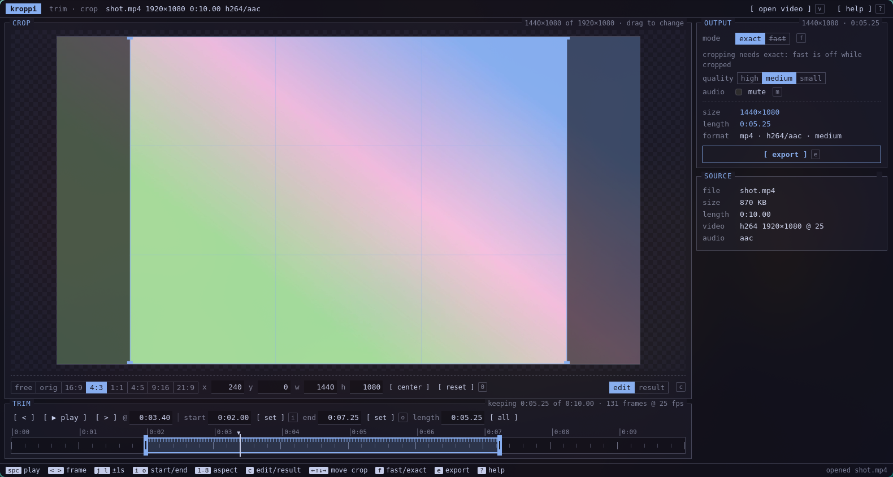

# kroppi

A Linux app for trimming and cropping videos. It looks like a terminal
program (but you can do everything with the mouse too).



## What it does

Open a video, keep the part you want, crop it if you like, and press
<kbd>e</kbd> to save it.

**Trim:** drag the start and end handles on the timeline, or type exact times
like `12.5` or `1:02.5`. <kbd>&lt;</kbd> and <kbd>&gt;</kbd> step one frame
at a time.

**Crop:** drag on the video to draw a crop, or pick an aspect ratio: 16:9,
4:3, 1:1, 4:5, 9:16, 21:9, the original's, or free. Picking one gives you the
biggest crop of that shape, so 16:9 footage becomes 4:3 with one key
(<kbd>4</kbd>). Move it with the mouse or the arrow keys, and press
<kbd>c</kbd> to see just the result.

**Save:** kroppi asks where to save and keeps the same format as the original
(mp4, mov, mkv or webm; anything else becomes mp4). There are two modes:

- **exact** re-encodes, so cuts land on the exact frame. Pick high, medium or
  small for the quality.
- **fast** copies the video as it is: instant and lossless, but cuts snap to
  the nearest keyframe, so the clip can start a little early. Cropping always
  needs a re-encode, so fast mode is off while there's a crop.

Audio is kept and trimmed with the video, or tick *mute* to drop it.
Everything stays on your computer.

## Install

The easiest way is a package from the
[latest release](https://github.com/wagidevnull/kroppi/releases/latest):

- **Debian / Ubuntu / Mint:** the `.deb`
- **Fedora / openSUSE:** the `.rpm`
- **Anything else:** the `.AppImage` (make it executable and run it)

Or use the install script, which works on any distro and puts kroppi in
your home folder (no root needed):

```sh
git clone https://github.com/wagidevnull/kroppi.git
cd kroppi
./install.sh
```

It builds kroppi if you have Rust installed, and otherwise downloads the
prebuilt app. It also offers to install the system packages kroppi needs:
WebKitGTK, the GStreamer video plugins, and `ffmpeg`, which does the actual
trimming and cropping.

```sh
kroppi              # open the app
kroppi clip.mp4     # open a video straight away
```

You can also right-click a video in your file manager and pick *Open with
kroppi*, or drop a video on the window.

To update, run `git pull && ./install.sh`. To remove it, run
`./install.sh --uninstall`.

## Keyboard

Press <kbd>?</kbd> in the app to see these.

| Key | Action |
|---|---|
| <kbd>space</kbd> | play / pause the selection |
| <kbd>&lt;</kbd> <kbd>&gt;</kbd> (or <kbd>,</kbd> <kbd>.</kbd>) | step one frame |
| <kbd>j</kbd> <kbd>l</kbd> | step one second |
| <kbd>i</kbd> / <kbd>o</kbd> | set start / end at the playhead |
| <kbd>{</kbd> <kbd>}</kbd> | slide the selection by one frame |
| <kbd>1</kbd>&ndash;<kbd>8</kbd> | crop to free, original, 16:9, 4:3, 1:1, 4:5, 9:16, 21:9 |
| arrows | move the crop (<kbd>shift</kbd> = 10 px) |
| <kbd>+</kbd> <kbd>-</kbd> | make the crop bigger / smaller |
| <kbd>0</kbd> / <kbd>x</kbd> | remove / center the crop |
| <kbd>c</kbd> | switch between editing the crop and seeing the result |
| <kbd>f</kbd> | switch between exact and fast |
| <kbd>m</kbd> | mute |
| <kbd>e</kbd> | export |
| <kbd>v</kbd> | open a video |

## Building

kroppi is a [Tauri](https://tauri.app) app: the interface is in `ui/` and
the Rust side (ffmpeg, the open and save dialogs, and a small local server
that streams the video to the window) is in `src-tauri/`.

```sh
cd src-tauri
cargo build --release        # target/release/kroppi
cargo test                   # ffmpeg command and server tests
python3 ../tests/app_test.py # drives the real app window
```

## License

MIT: see [LICENSE](LICENSE).
